<!-- Generated by scripts/build.py — edit the script or data/, not this file. -->

<a href="https://lrvdlinden.app"><picture><source media="(prefers-color-scheme: dark)" srcset="assets/hero-dark.svg"></picture></a>

<picture><source media="(prefers-color-scheme: dark)" srcset="assets/whoami-dark.svg"></picture>

<picture><source media="(prefers-color-scheme: dark)" srcset="assets/h-apps-dark.svg"></picture>

<a href="https://112heli.lrvdlinden.app"><picture><source media="(prefers-color-scheme: dark)" srcset="assets/app-112heli-dark.svg"></picture></a>
<a href="https://testflight.apple.com/join/Uy8yGMFY"><picture><source media="(prefers-color-scheme: dark)" srcset="assets/app-app-lrvdlinden-noodpakket-dark.svg"></picture></a>
<a href="https://apps.apple.com/nl/app/bekendr/id6832613749"><picture><source media="(prefers-color-scheme: dark)" srcset="assets/app-app-lrvdlinden-bekendr-dark.svg"></picture></a>
<a href="https://testflight.apple.com/join/xjwuY299"><picture><source media="(prefers-color-scheme: dark)" srcset="assets/app-nl-lrvdlinden-aalerts-dark.svg"></picture></a>
<a href="https://lrvdlinden.app/en/app/pairr/"><picture><source media="(prefers-color-scheme: dark)" srcset="assets/app-app-lrvdlinden-pairr-dark.svg"></picture></a>
<a href="https://lrvdlinden.app/en/app/homio/"><picture><source media="(prefers-color-scheme: dark)" srcset="assets/app-nl-lrvdlinden-homio-dark.svg"></picture></a>
<a href="https://testflight.apple.com/join/bjhRGGG8"><picture><source media="(prefers-color-scheme: dark)" srcset="assets/app-nl-lrvdlinden-liftr-dark.svg"></picture></a>
<a href="https://apps.apple.com/nl/app/pasr-klantenkaarten/id6829229123"><picture><source media="(prefers-color-scheme: dark)" srcset="assets/app-nl-lrvdlinden-pasr-dark.svg"></picture></a>
<a href="https://apps.apple.com/us/app/weekdot/id6826670273"><picture><source media="(prefers-color-scheme: dark)" srcset="assets/app-nl-lrvdlinden-weekdot-dark.svg"></picture></a>
<a href="https://apps.apple.com/nl/app/bingr/id6821401598"><picture><source media="(prefers-color-scheme: dark)" srcset="assets/app-bingr-dark.svg"></picture></a>
<a href="https://apps.apple.com/nl/app/healthsync/id6820227732"><picture><source media="(prefers-color-scheme: dark)" srcset="assets/app-healthsync-dark.svg"></picture></a>
<a href="https://apps.apple.com/us/app/devtools/id6826116132"><picture><source media="(prefers-color-scheme: dark)" srcset="assets/app-devtools-dark.svg"></picture></a>
<a href="https://testflight.apple.com/join/Fvr4DAP6"><picture><source media="(prefers-color-scheme: dark)" srcset="assets/app-tunr-dark.svg"></picture></a>

<a href="https://apps.apple.com/nl/developer/leon-van-der-linden/id607860328"><picture><source media="(prefers-color-scheme: dark)" srcset="assets/classics-dark.svg">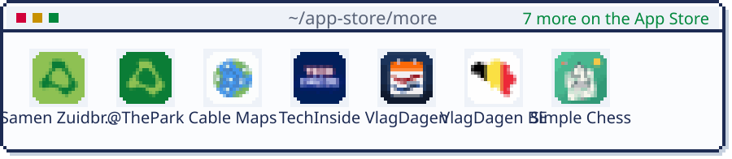</picture></a>

<picture><source media="(prefers-color-scheme: dark)" srcset="assets/h-homey-dark.svg"></picture>

<a href="https://homey.app/nl-nl/apps/author/5d4da77a2c836a50f6936070/page/0/"><picture><source media="(prefers-color-scheme: dark)" srcset="assets/homey-dark.svg">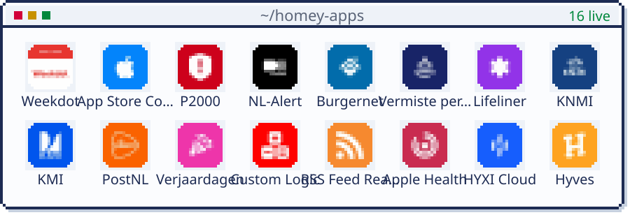</picture></a>

Homey App Store: <a href="https://homey.app/nl-nl/apps/author/5d4da77a2c836a50f6936070/page/0/">Léon van der Linden</a> · <a href="https://homey.app/nl-nl/apps/author/6ac4bc064c7de6266bbdb73e/page/0/">PixelForges</a> · <a href="https://community.homey.app/t/apps-made-by-lrvdlinden/85452">Community topic</a>

<picture><source media="(prefers-color-scheme: dark)" srcset="assets/h-stack-dark.svg"></picture>

<picture><source media="(prefers-color-scheme: dark)" srcset="assets/stack-dark.svg">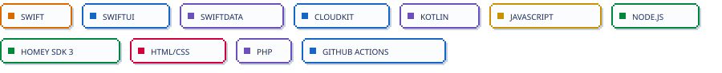</picture>

<picture><source media="(prefers-color-scheme: dark)" srcset="assets/h-stats-dark.svg"></picture>

<picture><source media="(prefers-color-scheme: dark)" srcset="assets/stats-dark.svg">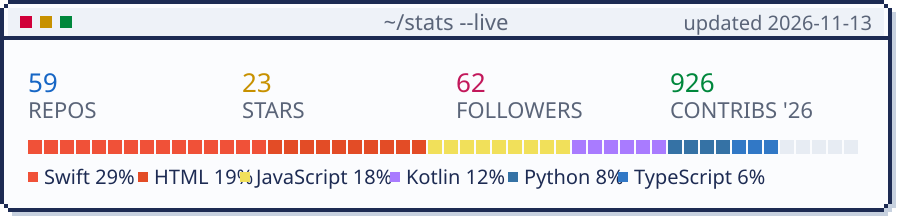</picture>

<picture><source media="(prefers-color-scheme: dark)" srcset="https://raw.githubusercontent.com/LRvdLinden/LRvdLinden/output/github-snake-dark.svg"></picture>

<a href="https://lrvdlinden.app/donate"><picture><source media="(prefers-color-scheme: dark)" srcset="assets/footer-dark.svg"></picture></a>

<a href="https://lrvdlinden.app">lrvdlinden.app</a> · <a href="https://apps.apple.com/nl/developer/leon-van-der-linden/id607860328">App Store</a> · <a href="https://homey.app/nl-nl/apps/author/5d4da77a2c836a50f6936070/page/0/">Homey</a> · <a href="https://lrvdlinden.app/donate">Donate</a>

